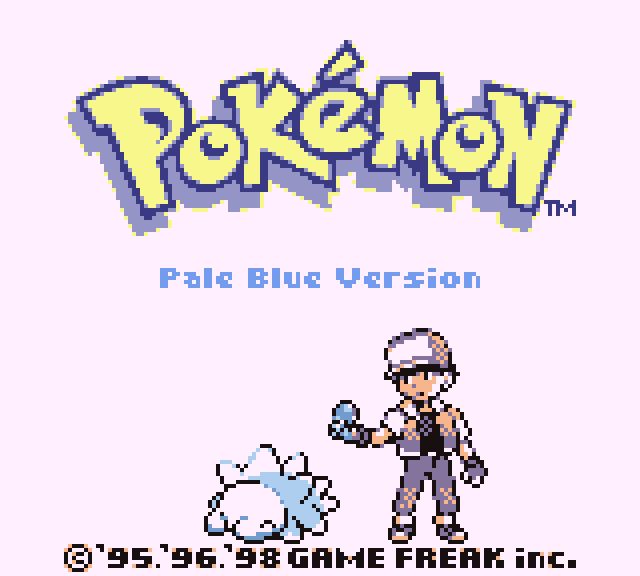

# Pokémon Pale Blue

A Pokémon Blue hack: your starter is a Snom, and it's the only Pokémon you'll ever have.

- No catching, trading or gift Pokémon. Snom never evolves.
- HMs work from the bag.
- Marts sell Ethers and Elixirs; every Pokémon Center has a free move relearner.
- There might be something under the truck.

Build with RGBDS 1.0.4: `make blue` (no ROM included).

## The agent

The plan is to train a local agent to beat Pale Blue on its own, with no one at the
controls. It'll build on what's already here: `playtest/` plays the game headlessly and
finds walking routes from the map data, and `stats/` has an mGBA script that logs every
battle and turn of a human run to compare against. This repo will be updated as it makes
progress.

## Artwork

`artwork/box_art.png` is box art for your ROM collection. It's built from
[jadelune's HQ recreation of the Blue box](https://www.deviantart.com/jadelune) with Snom's
official artwork; `art/cover/boxedit/` has the scripts.

## Credits

Built on [pret/pokered](https://github.com/pret/pokered). Snom sprites from
[pokeemerald-expansion](https://github.com/rh-hideout/pokeemerald-expansion).
