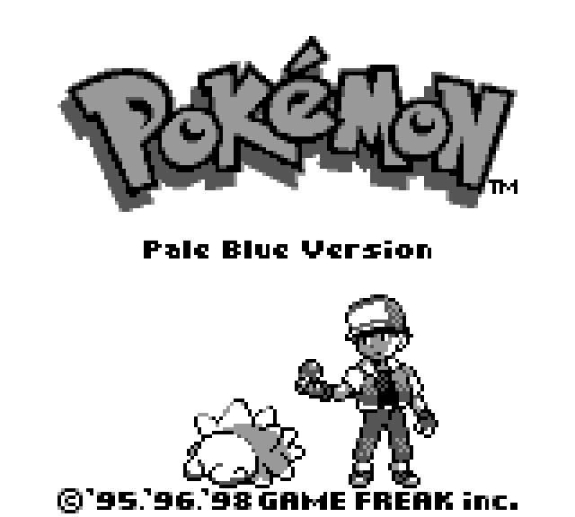

<h1 align="center">Pokémon Pale Blue</h1>

A Pokémon Blue hack: Pretty much the same except your starter pokemon is Snom. And you can't catch anything. Or trade. Or evolve.

- Original 151 Pokémon + Snom
- HMs work from the bag.
- Marts sell Ethers and Elixirs
- Every Pokémon Center has a free move relearner - you'll need it
- The truck is still there. Probably nothing.

It's been beaten start to finish.

## Agent progress 

A local agent is learning to play Pale Blue with no one at the controls. New entries go
here as it gets further.

| Date | Milestone | Notes |
| --- | --- | --- |
| | Not started yet | |

## Playing it

Download `pale_blue.bps` from [Releases](https://github.com/jordanpainter/paleblue/releases)
and apply it to your own Pokémon Blue ROM (the English USA/Europe release) with
[Rom Patcher JS](https://www.marcrobledo.com/RomPatcher.js/), in your browser. It works on
Game Boy and Super Game Boy.

Or build it yourself: install [RGBDS](https://rgbds.gbdev.io) 1.0.4 and run `make blue`.

## The agent

The goal is an agent that runs on a home machine and beats the whole game on its own.
How it's built, and why, will go here as it takes shape.

## Credits

Built on [pret/pokered](https://github.com/pret/pokered). Snom sprites from
[pokeemerald-expansion](https://github.com/rh-hideout/pokeemerald-expansion). Thanks to
JadeLune for the [HQ Blue box art](https://www.deviantart.com/jadelune/art/Pokemon-Blue-Version-Game-Boy-HQ-Box-Art-593872935)
that `artwork/box_art.png` is built on.
